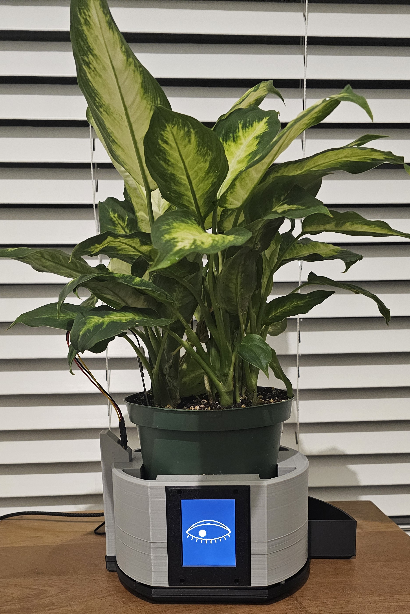
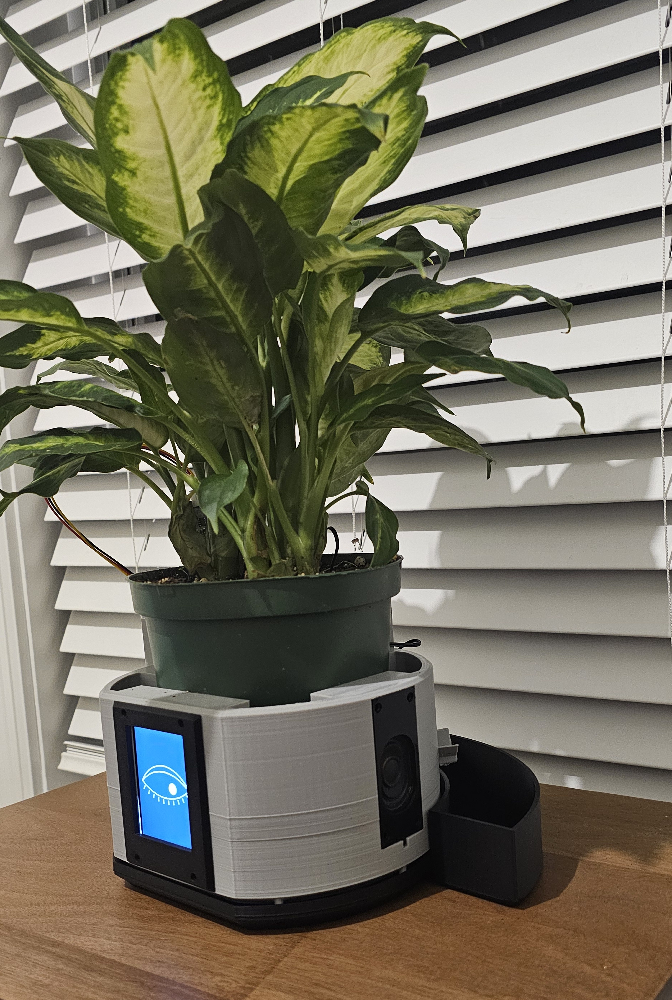
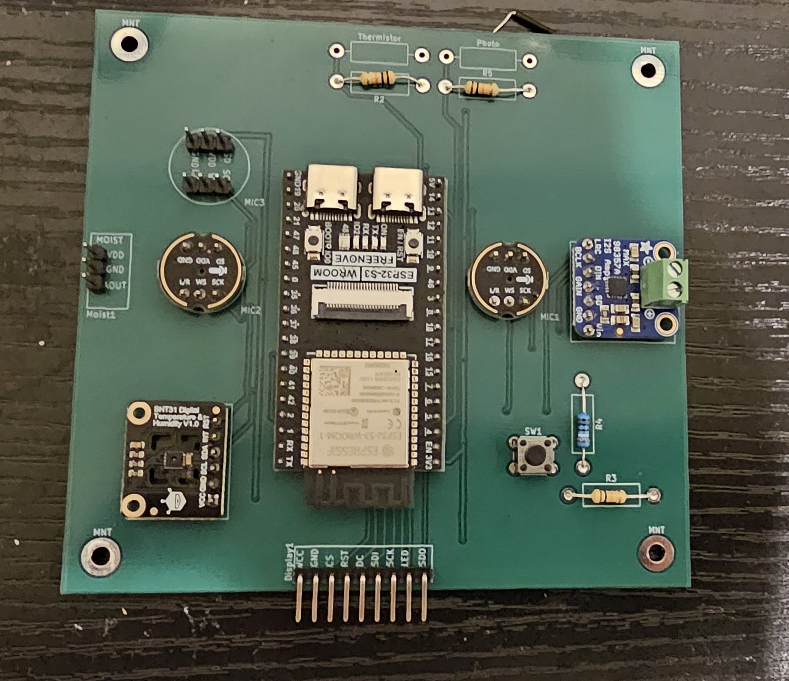

# Gary

  

Gary was built with the purpose of reminding me to water my plants because I kept killing them. The idea was to create a robot that would be interesting to interact with while also being useful enough to justify using it. He was built over the course of about 2 months, including hardware and software. 

Unlike most AI powered robots online, Gary does not speak with an AI voice but instead through a collection of beeps like a video game NPC. I personally do not like how AI's sound or speak so I opted to use a collection of prewritten text and a decision model to decide what Gary should say in any given situation. For now Gary only reacts to changes in his environment, i.e when it gets too cold or if you over or underwater him. I am currently working on voice activity detection system for Gary to allow for more dynamic interactions however. 

  

Much of the software is still in the works - including Gary's personality, the VADNet model and the network capabilities. After finishing the hardware I realized that some of the core functionality of Gary was no longer feasible -> mainly the sound tracking. Gary was supposed to have his eye follow you depending on where your voice was coming from, but unfortunately the round edges of the enclosure causes the sound to echo, making the eye tracking too unstable to be used. 

  

If you look closely you can notice that there are two microphones on the board, with headers for a third. This is because I wanted to triangulate the position of where sound is coming from to allow Gary's eye to look at the user without needing a camera. This worked reasonably well on a breadboard, but unfortunately the design of the enclosure causes the sound to vibrate off the walls, making Gary's eye movement unstable. I have experimented somewhat in lining the walls in cloth, but it doesn't seem to fix the problem. I will probably be scrapping the idea making two out of the three microphones redundant.

This is also the reason why the PCB is so much wider than it needed to be, as the extra distance was needed to give the microphones enough time to detect where the sound was originating from in each frame. I could have probably made the shape of the board less boxy - but I wasn't thinking about aesthetics at the time. In retrospect I think it would have been a lot nicer to go back and spend more time on how I wanted the PCB to look.

It's the first PCB I've ever designed and it was the first time I've ever touched KiCAD. I will admit it is not the nicest looking PCB and it was more expensive to manufacture than it should have been, but it has a special place in my heart. I learnt a lot from this project and next time I want to make a board using actual components instead of prebuilt modules. 

It does work though, which is nice.

### Project Plans

The next step is to get Gary's state machine working and to overhaul the animation system. While most of the code in this project was either manually written or at least heavily monitored, the display code for the eye is almost entirely vibe-coded. This was mainly a practical concern as drawing a PNG to the screen every frame was too slow and figuring out how to draw everything as a collection of vectors manually was too time consuming. This project was mainly for me to learn to work with hardware so I didn't want to spend weeks writing the eye tracking logic. 

In the future I want to connect Gary to my home network so he can detect when I'm home by pinging my phone. I might also link Gary to my MQTT brokerage so I can control him via a website or to collect information in a centralized database. Gary already has an SD card for storing data on device so that would be mainly for learning or if I wanted to add more AI features.

### Hardware issues

Gary is not waterproof... at all. The aquaduct works well and as long as no water gets on the side it should be fine but there is no sealant on his base and the speaker is almost entirely exposed. I do not intend to ever have Gary be mass manufactured (I don't even know how that would be possible) so I'm ok with this risk.

The screw holes for the speaker do not line up correctly. I can't fix this because the FreeCAD files got corrupted when making the collection tray, but also I am unwilling to spend another 16 hours printing the main enclosure for the third time.